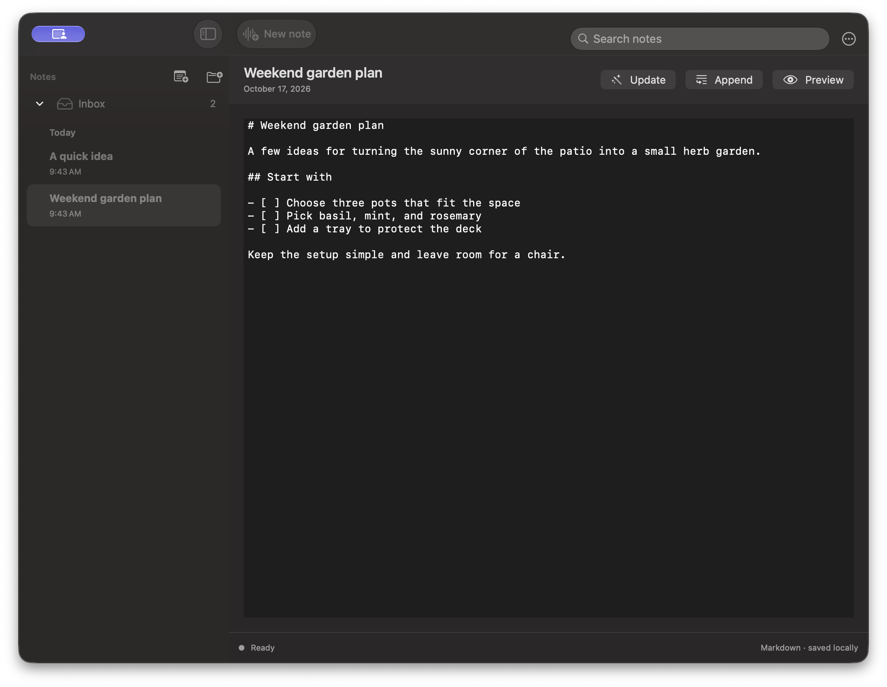
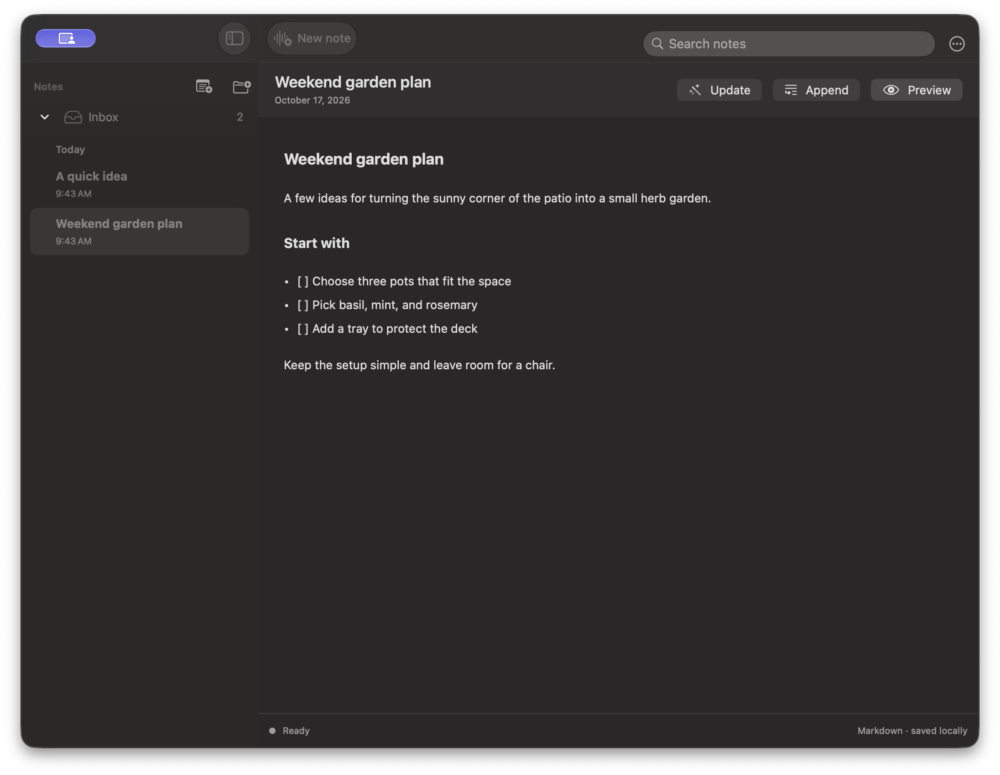

<p align="center">
  
</p>

<h1 align="center">FreeFlow Notes</h1>

<p align="center">
  Open-source macOS dictation and voice notes, saved as Markdown.

Free and open source alternative to <a href="https://wisprflow.ai">Wispr Flow</a>, <a href="https://superwhisper.com">Superwhisper</a>, and <a href="https://monologue.to">Monologue</a>.
</p>

<p align="center">
  <a href="https://github.com/bharat2808/freeflow-notes/releases/latest/download/FreeFlow-Notes.dmg"><b>⬇ Download FreeFlow Notes</b></a><br>
  <sub>Universal build for Apple Silicon and Intel · <a href="https://github.com/bharat2808/freeflow-notes">Source code</a></sub>
</p>

---

## App preview

<p align="center">
  
</p>

<p align="center">
  
</p>

<p align="center">
  <i>FreeFlow Notes builds on <a href="https://github.com/zachlatta/freeflow">FreeFlow</a> by Zach Latta and its contributors.</i>
</p>

## Overview

FreeFlow Notes is a free, open-source macOS app for dictation and voice notes. Dictate into the app you are using, or capture a thought as a Markdown note. Notes stay on your Mac.

## Quick Start

1. Download the universal Mac app above.
2. Choose hosted transcription with your provider API key, or configure local Whisper in Settings.
3. Use the shortcut shown during setup to dictate into the focused text field. Open Notes from the menu bar to save speech as Markdown.

## Features

- **Custom shortcuts:** Customize both hold-to-talk and toggle dictation shortcuts. If your toggle shortcut extends your hold shortcut, you can start in hold mode and press the extra modifier keys to latch into tap mode without stopping the recording.
- **Context-aware cleanup:** FreeFlow can read nearby app context so names, terms, and phrases are spelled correctly when you dictate into email, terminals, docs, and other apps.
- **Custom vocabulary:** Add names, jargon, and project-specific words that FreeFlow should preserve during cleanup.
- **Voice notes:** Record, edit, append to, and organize notes in folders. Notes are saved as Markdown files on your Mac.
- **Local transcription:** Configure a local Whisper model when you want transcription to run on your Mac.
- **OpenAI-compatible providers:** Use Groq by default, or configure a custom model and API URL in settings.

## Edit Mode

Edit Mode lets you highlight existing text and transform it with a spoken instruction, like "make this shorter" or "turn this into bullets." Enable it in settings, then use your normal dictation shortcut on selected text, or choose Manual mode to require an extra modifier key.

## Privacy

Notes are stored locally as Markdown. If you choose hosted transcription or cleanup, the audio, text, or app context needed for that feature is sent to the provider configured in Settings. Local Whisper transcription can run on your Mac.

## Custom Cleanup

If you'd rather keep cleanup more literal and less context-aware, you can paste this simpler prompt into the custom system prompt setting:

<details>
  <summary>Simple post-processing prompt</summary>

  <pre><code>You are a dictation post-processor. You receive raw speech-to-text output and return clean text ready to be typed into an application.

Your job:
- Remove filler words (um, uh, you know, like) unless they carry meaning.
- Fix spelling, grammar, and punctuation errors.
- When the transcript already contains a word that is a close misspelling of a name or term from the context or custom vocabulary, correct the spelling. Never insert names or terms from context that the speaker did not say.
- Preserve the speaker's intent, tone, and meaning exactly.

Output rules:
- Return ONLY the cleaned transcript text, nothing else. So NEVER output words like "Here is the cleaned transcript text:"
- If the transcription is empty, return exactly: EMPTY
- Do not add words, names, or content that are not in the transcription. The context is only for correcting spelling of words already spoken.
- Do not change the meaning of what was said.

Example:
RAW_TRANSCRIPTION: "hey um so i just wanted to like follow up on the meating from yesterday i think we should definately move the dedline to next friday becuz the desine team still needs more time to finish the mock ups and um yeah let me know if that works for you ok thanks"

Then your response would be ONLY the cleaned up text, so here your response is ONLY:
"Hey, I just wanted to follow up on the meeting from yesterday. I think we should definitely move the deadline to next Friday because the design team still needs more time to finish the mockups. Let me know if that works for you. Thanks."</code></pre>
</details>

## Using a Local Model

FreeFlow can use OpenAI-compatible local or self-hosted providers instead of Groq. In settings, configure the API base URL and model IDs for your local LLM provider, such as Ollama, LM Studio, or another OpenAI-compatible server. If your transcription backend uses a different endpoint from your LLM backend, set the transcription API URL separately.

Local models are often slower than hosted providers, especially on cold start, long recordings, or busy hardware.

<details>
  <summary>Configure longer timeouts for local models</summary>

  FreeFlow Notes keeps the default network timeout at 20 seconds, but you can extend it with macOS defaults:

```bash
defaults write com.bharat2808.freeflownotes transcription_timeout_seconds -float 120
defaults write com.bharat2808.freeflownotes post_processing_timeout_seconds -float 120
defaults write com.bharat2808.freeflownotes context_request_timeout_seconds -float 120
```

The timeout keys are:

- `transcription_timeout_seconds`: audio transcription requests
- `post_processing_timeout_seconds`: transcript cleanup and edit mode requests
- `context_request_timeout_seconds`: nearby app context requests

Only positive values are used. Remove a custom timeout to return to the 20-second default:

```bash
defaults delete com.bharat2808.freeflownotes transcription_timeout_seconds
defaults delete com.bharat2808.freeflownotes post_processing_timeout_seconds
defaults delete com.bharat2808.freeflownotes context_request_timeout_seconds
```

</details>

## License

Licensed under the MIT license.
